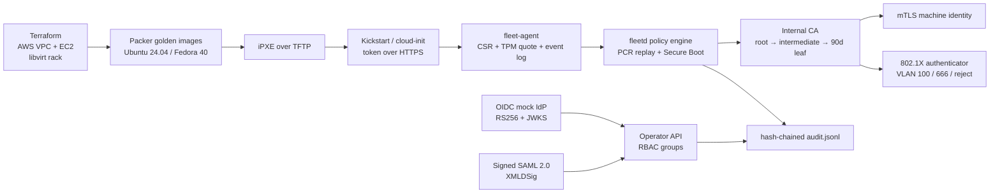

# FleetProvision

FleetProvision is a 0-to-1 bootstrap system for a hybrid estate: Terraform builds
an AWS VPC/EC2 footprint and a local libvirt/QEMU rack, Packer builds golden
Ubuntu and Fedora images, bare nodes boot unattended through DHCP → iPXE →
Kickstart/cloud-init, and every node must prove its boot integrity through UEFI
Secure Boot state and TPM PCR measurements before the internal CA issues a
production identity. A Rust control plane (`fleetd`) and CLI (`fleetctl`)
separate machine mTLS identities from human OIDC/SAML identities, enforce CRLs,
and write a hash-chained audit log. A deterministic simulator runs the whole
pipeline on one machine over real sockets.

## Architecture



### Components

| Path | Responsibility |
| --- | --- |
| `crates/fleet-pki` | Root/intermediate CA, CSR signing, SAN identities, rotation, CRL v2, CRL freshness |
| `crates/fleet-attest` | Secure Boot state, TCG event-log replay, TPM quote verification, policy engine, fixtures |
| `crates/fleet-proto` | Shared request/response, state machine, node summaries |
| `crates/fleetd` | mTLS control plane, enrollment/quarantine/revocation, OIDC + SAML operators, audit log, `fleet-agent` binary |
| `crates/fleetctl` | CA/operator CLI, device-flow login, attestation matrix, audit verification |
| `crates/fleet-sim` | DHCP/TFTP/DNS/HTTP servers, 802.1X authenticator, e2e harness, mock IdP, benchmark |
| `terraform/modules/aws_vpc` | Two-AZ VPC, public/private subnets, NAT, fleetd/SSH security groups |
| `terraform/modules/aws_node` | EC2 node, instance profile (SSM only), IMDSv2, cloud-init enrollment |
| `terraform/modules/onprem_rack` | libvirt bridge network, PXE-first domains, OVMF, virtual TPM 2.0 |
| `terraform/envs/dev`, `envs/onprem` | Compositions, offline validation, backend examples |
| `packer/ubuntu`, `packer/fedora` | qemu HCL2 builds, autoinstall/Kickstart HTTP, Ansible role, image digests |
| `ansible/roles/fleet_node` | Agent install, trust bundle, systemd units, chrony, sshd hardening; idempotent |
| `provisioning/` | iPXE chain, Kickstart, cloud-init templates, systemd units |
| `policy/boot-integrity.yaml` | Secure Boot/PCR allowlists and `on_fail: quarantine` |
| `fixtures/` | Nine committed attestation fixtures and signed SAML fixtures |
| `results/` | Real measurement output (`metrics.json`, `REPORT.md`, matrices) |

### Two credential paths

| | Machine (node) | Human (operator) |
| --- | --- | --- |
| Credential | X.509 leaf, ECDSA P-256, 90 days | OIDC RS256 JWT or signed SAML assertion |
| TLS | Mandatory client certificate on `:8443` | Server TLS on `:9443`, bearer token |
| Enrollment | Single-use HMAC bootstrap token on `:8444` | OIDC device-authorization grant |
| Authorization | SAN `fleet://<site>/<node-id>`, CRL checked at handshake | `fleet-admin` (write) / `fleet-operator` (read) |
| Never allowed | Calling operator endpoints | Calling `/v1/enroll` or node endpoints |
| Audit | every enroll/revoke/renew/policy failure/VLAN | every login and admin action |

## How to run

### Prerequisites

* Rust stable — pinned by `rust-toolchain.toml` (1.99.1)
* Terraform ≥ 1.6 (tested with 1.16.5)
* Packer ≥ 1.10 (tested with 1.16.1) and `ansible-playbook` for Packer validation
* `ansible-lint` (tested with 26.10.1)
* Python 3 with PyYAML for the CI YAML check (the repo uses `.venv-tools` when present)
* Linux/KVM host for an actual Packer build; libvirt host for `envs/onprem` apply

```bash
git clone <this-repo> FleetProvision
cd FleetProvision
make build
make test
```

### Validate infrastructure without credentials

```bash
make iac-validate
```

This runs `terraform fmt -check`, `init -backend=false` + `validate` for all
three modules and both environments, `terraform plan` for `envs/dev` with dummy
credentials (27 resources planned), `packer init && packer validate` for both
templates, and `ansible-lint`. Real output is in `results/iac-validate.txt` and
`results/iac-plan-counts.json`.

### Run the full boot → attest → enroll → 802.1X simulation

```bash
make e2e          # 20 nodes by default; writes results/e2e.txt and e2e.json
make bench        # writes results/metrics.json and results/REPORT.md
```

`make e2e` starts an in-process `fleetd`, mock OIDC IdP, DHCP, TFTP, DNS, HTTP,
and 802.1X authenticator, then boots N simulated nodes concurrently over real
sockets. Each node performs DHCP, fetches iPXE, fetches Kickstart/cloud-init and
a token, obtains a nonce, signs a TPM quote with a simulated AK, enrolls over
HTTPS, and authorizes onto VLAN 100.

### Operator login (OIDC device flow)

```bash
# terminal 1
./target/debug/fleet-sim idp --listen 127.0.0.1:8080

# terminal 2
cargo build -p fleetd -p fleetctl
./target/debug/fleetctl --state-dir ./state ca init
./target/debug/fleetd --state-dir ./state \
  --listen 127.0.0.1:8443 --enroll-listen 127.0.0.1:8444 \
  --operator-listen 127.0.0.1:9443 --oidc-issuer http://127.0.0.1:8080

# terminal 3
./target/debug/fleetctl --state-dir ./state --server https://127.0.0.1:9443 \
  login --idp http://127.0.0.1:8080 --group fleet-admin
./target/debug/fleetctl --state-dir ./state --server https://127.0.0.1:9443 node list
./target/debug/fleetctl --state-dir ./state audit verify
```

The mock IdP auto-approves device codes; it still issues real RS256 JWTs,
publishes `/.well-known/openid-configuration` and `/jwks`, and enforces
iss/aud/exp/nbf/kid. Use `--group fleet-operator` to demonstrate read-only RBAC.

SAML fixtures can be checked without a browser:

```bash
./target/debug/fleetctl saml verify --response fixtures/saml/valid.xml
./target/debug/fleetctl saml verify --response fixtures/saml/unsigned.xml  # fails
```

### Point `envs/dev` at a real AWS account

`envs/dev` defaults to dummy credentials and validation skips for offline
planning. For a real deployment:

1. Build an AMI on a KVM host: `cd packer/ubuntu && packer init . && packer build .`
2. Set real credentials (`AWS_PROFILE`/SSO), and override `aws_access_key`,
   `aws_secret_key`, `node_ami`, `bootstrap_token`, and `trust_bundle`.
3. Generate a token per node: `fleetctl token create --node-id ... --out token`.
4. `cd terraform/envs/dev && terraform init -backend-config=backend.hcl && terraform apply`.

**Warning:** this creates billable AWS resources (EC2, NAT gateway, EIP, EBS).

### Other useful commands

```bash
./target/debug/fleetctl ca init --state-dir ./state
./target/debug/fleetctl ca issue --node-id n1 --state-dir ./state
./target/debug/fleetctl ca verify --node-id n1 --state-dir ./state
./target/debug/fleetctl attest check --fixture fixtures/ubuntu-good.json
./target/debug/fleet-sim render-ipxe --inventory fleet.yaml --out out/pxe \
  --token-dir out/tokens --ca-bundle state/trust-bundle.pem
./target/debug/fleet-sim gen-fixtures --out fixtures
```

## Results

All figures below come from `results/metrics.json` and `results/REPORT.md`,
produced by `make bench` on this machine. Machine: macOS 27.0.1, Apple M3
(aarch64), 16 GB RAM. Tools: `rustc 1.99.1`, Terraform 1.16.5, Packer 1.16.1,
ansible-lint 26.10.1. Measurement timestamp: 2026-10-19T20:57:31Z.

### CA issuance (1,000 leaf certificates)

| Metric | Value |
| --- | --- |
| Throughput | **7,664.5 certs/s** |
| p50 / p95 / p99 / max | **0.09 / 0.09 / 0.15 / 0.30 ms** |

### mTLS handshakes (500 real connections) and revocation

| Metric | Value |
| --- | --- |
| Handshake p50 / p95 / p99 | **0.30 / 0.42 / 0.53 ms** |
| Revoked-cert attempts | **100 rejected at handshake** |
| Revoked rejection p50 / p95 / p99 | **0.43 / 0.52 / 0.65 ms** |

### Concurrent enrollment (end-to-end)

| Nodes | Succeeded | Wall | Nodes/sec | Per-node p50 / p95 |
| --- | --- | --- | --- | --- |
| 20 | 20 | 427 ms | **46.8** | 138 / 214 ms |
| 100 | 100 | 1,388 ms | **72.1** | 695 / 1,152 ms |

### Attestation policy evaluation (1,000 blobs)

p50 **0.26 ms**, p95 **0.27 ms**, p99 **0.35 ms**. The committed fixture matrix
is **2 pass / 7 fail**:

| Fixture | Verdict |
| --- | --- |
| `ubuntu-good.json` | PASS |
| `fedora-good.json` | PASS |
| `secureboot-off.json` | `secure_boot_disabled` |
| `setup-mode-on.json` | `setup_mode_enabled` |
| `tampered-shim.json` | `pcr_not_allowed` (PCR4) |
| `replayed-nonce.json` | `replayed_nonce` |
| `forged-quote.json` | `forged_quote` |
| `log-quote-mismatch.json` | `log_quote_mismatch` (PCR4) |
| `unknown-firmware.json` | `pcr_not_allowed` (PCR0) |

### Provisioning simulation

| Nodes | Success | Wall | VLAN 100 | VLAN 666 | Rejected | Boot→enrolled p50 / p95 |
| --- | --- | --- | --- | --- | --- | --- |
| 20 | 20/20 | 270 ms | 20 | 0 | 0 | 123 / 188 ms |
| 100 | 100/100 | 1,115 ms | 100 | 0 | 0 | 560 / 981 ms |

802.1X outcome matrix (deliberate scenarios): **1 VLAN 100, 1 VLAN 666,
1 rejected** (p50 0.80 ms). The 20/100-node runs authorized every node to
VLAN 100.

Deliberate failure injection: **6 of 6 scenarios failed closed** — DHCP unknown
MAC (NAK), TFTP missing file, HTTP 404 Kickstart, truncated TLS handshake
(handshake failure counted, server stayed up), expired CRL (`stale_crl`), and
revoked supplicant (`revoked`).

### Project totals

* Tests: **117** (`cargo test --workspace -- --list`)
* Terraform resources planned in `envs/dev`: **27**
* Terraform modules/environments validated: **5**
* Attestation fixtures: **9**

## Security notes

**Real:** X.509 chain building and EKU enforcement, ECDSA P-256 signatures,
128-bit serials, 90-day leaves, CRL v2 reason codes and `nextUpdate` freshness,
HMAC single-use bootstrap tokens, RS256 JWTs validated against a live JWKS,
XMLDSig verification over SAML assertions, hash-chained audit records, TLS 1.2/1.3
client-certificate verification at handshake time.

**Simulated:** TPM quotes are signed by a software P-256 AK key rather than a
hardware TPM; the AK certificate is issued by the fleet CA through a
token-gated `/v1/ak` endpoint (a real deployment would provision a vendor EK/AK
chain in the image). The 802.1X authenticator uses an EAP-TLS-shaped JSON
handshake over TCP, not EAPOL frames. The mock IdP auto-approves device codes
and stores grants in memory. Fixture private keys under `fixtures/` are
test-only. `terraform plan` and Packer validation do not create cloud resources
or boot a VM.

**Threat model covered:** firmware or bootloader tampering (PCR0/PCR4
allowlists), Secure Boot disabled or left in Setup Mode, dbx missing known-bad
shim revocations, forged or replayed TPM quotes, stale CRLs, revoked node
credentials, replayed bootstrap tokens, operator group escalation, and audit-log
tampering. **Not covered:** physical TPM bus attacks, hypervisor/firmware
compromise below the measured boundary, supply-chain compromise of the `fleetd`
binary, stolen operator JWTs before expiry, and a compromised CA host.

## Limitations and next steps

* Packer images were **validated, not built** here: an actual build needs a
  Linux/KVM host and the Ubuntu/Fedora ISOs. `make iac-validate` is the
  reproducible check in this environment.
* Terraform was validated and planned offline; no AWS or libvirt apply was run
  (cost/hardware). `envs/dev` has a commented S3+DynamoDB backend and
  `backend.hcl.example`.
* TPM quotes are software-signed; hardware TPM 2.0 and real OVMF Secure Boot
  variables are not exercised.
* SAML verification is a narrow profile (one signed assertion, RSA-SHA256,
  exclusive C14N) exposed as a CLI verifier; a browser ACS endpoint is future
  work.
* Single control-plane instance with JSON state and an in-memory JWKS cache;
  production needs HA storage and CRL/OCSP distribution at scale.
* Fedora 40 is EOL; the template points at the Fedora archive. Move to a
  supported release before production use.
* Benchmark numbers are from one Apple M3 laptop and will vary by host.
